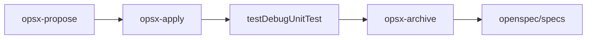

# Как менять «Поток» / TimeDial

Любое изменение приложения начинается со спецификации и заканчивается архивом. Миссия — зачем продукт существует. Спеки — что уже обещано в текущей сборке. Код подстраивается под спеку через отдельное изменение, а не наоборот.

## Начать изменение

В чате Cursor напишите `/opsx-propose` и коротко, что должно измениться. То же самое делают `/openspec-propose` и фраза «opsx propose».

Появится папка изменения: зачем оно, что система должна делать, как это устроить и список шагов. Пока вы не попросите применить изменение, код приложения не трогается.

Если предложение не помогает ни одному пункту миссии, его не берут в работу.

## Применить

Когда предложение устраивает, напишите `/opsx-apply` и имя изменения. Агент выполняет шаги из списка и отмечает их.

Перед архивом набор модульных тестов должен пройти. Если тесты красные, изменение остаётся открытым.

## Заархивировать

Напишите `/opsx-archive` и имя изменения. Дельта вливается в действующие спеки, папка уходит в архив. Пока тесты не зелёные, архивировать нельзя.

Действующие спеки после этого — источник правды о поведении сборки. Править их руками нельзя: расхождение кода и спеки закрывается новым изменением.

## Что уже зафиксировано

Сохранены список задач, живая сессия погружения и циферблат дня. Библиотека туториалов из миссии в этой сборке отсутствует: нет курса, повторных прохождений, своих уроков, публикации, скачивания и удаления. Макеты «Практика» — рисунки, не экран. Курс появится только отдельным изменением.

## Секреты

Файлы с ключами не кладут в рабочую папку. Список в `.cursorignore` закрывает их от агента, подсказок Tab и упоминания через `@`.

Это не стена. Терминал и MCP-серверы этот список не читают и файл откроют. Поэтому боевые ключи в каталоге проекта не хранят. Проверочный `credentials.json` с выдуманным содержимым как раз показывает границу: агент его не читает, терминал — читает.

## Проверка

1. Предложите мелкое изменение через `/opsx-propose`.
2. Убедитесь, что в папке изменения есть предложение, спека и список шагов, а код приложения ещё не менялся.
3. Попросите применить и дождитесь зелёных модульных тестов.
4. Заархивируйте и откройте действующие спеки: в них появилось поведение из дельты.

---

# Техническое приложение

## Файлы

| Путь | Зачем |
|---|---|
| `spec/mission.md` | Миссия, шаги а–д, принципы, блок обучения, mission-fit |
| `openspec/config.yaml` | Контекст проекта для OpenSpec, `skillsScope: project` |
| `openspec/specs/` | Действующие контракты после архива |
| `openspec/changes/<name>/` | Активное изменение: `proposal.md`, `design.md`, `tasks.md`, `specs/` |
| `openspec/changes/archive/` | Завершённые изменения |
| `.agents/skills/openspec-*` | Навыки OpenSpec 2.1: propose, apply, archive |
| `.cursor/commands/opsx-*.md` | Короткие слэш-команды, которые ведут в эти навыки |
| `.cursorignore` | Шаблоны секретов для Agent, Tab и `@` |
| `AGENTS.md` | Ограничения стека и правило цикла SDD |

## Методы и параметры

Цикл CLI, из корня репозитория:

| Команда | Что делает |
|---|---|
| `openspec validate <name> --strict` | Проверяет дельту до архива |
| `openspec archive <name> --yes` | Вливает дельту в `openspec/specs/` и переносит папку в архив |
| `gradlew.bat :app:testDebugUnitTest` | Модульные тесты; обязательны перед архивом |
| `gradlew.bat :app:assembleDebug` | Debug-сборка |

OpenSpec CLI в этом репозитории: `@fission-ai/openspec` 2.1.0. Версия 2.1 ставит навыки в `.agents/skills/` и сама больше не генерирует `/opsx-*` в `.cursor/commands/`. Файлы `opsx-propose.md`, `opsx-apply.md` и `opsx-archive.md` добавлены в репозиторий вручную и ссылаются на навыки. Те же шаги вызываются как `/openspec-propose`, `/openspec-apply-change`, `/openspec-archive-change`.

Имена capabilities: `task-list`, `flow-session`, `day-dial`, `learning-library`.

## Примеры

Предложение без правки кода:

```bat
openspec new change add-baseline-task-list
openspec validate add-baseline-task-list --strict
```

Архив после зелёных тестов:

```bat
gradlew.bat :app:testDebugUnitTest
openspec archive add-baseline-task-list --yes
```

Граница секретов: `@credentials.json` в чате агента не открывается. В терминале файл читается, потому что `.cursorignore` на терминал не действует:

```bat
type credentials.json
```

## Блок-схема


