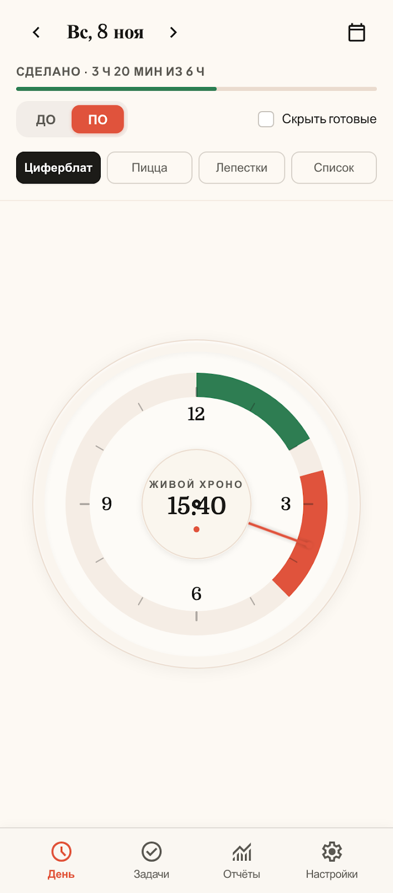
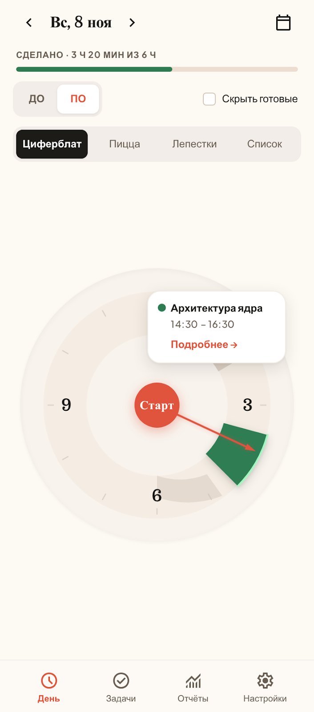
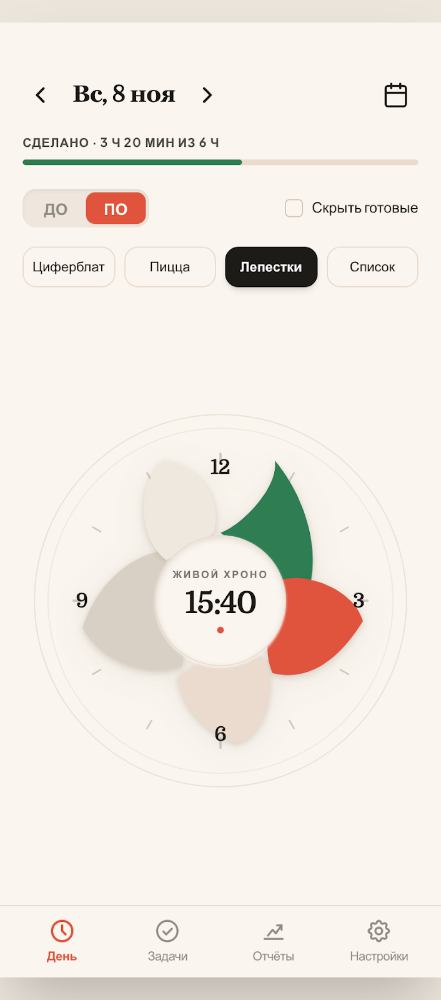
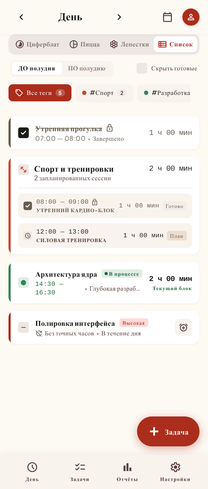
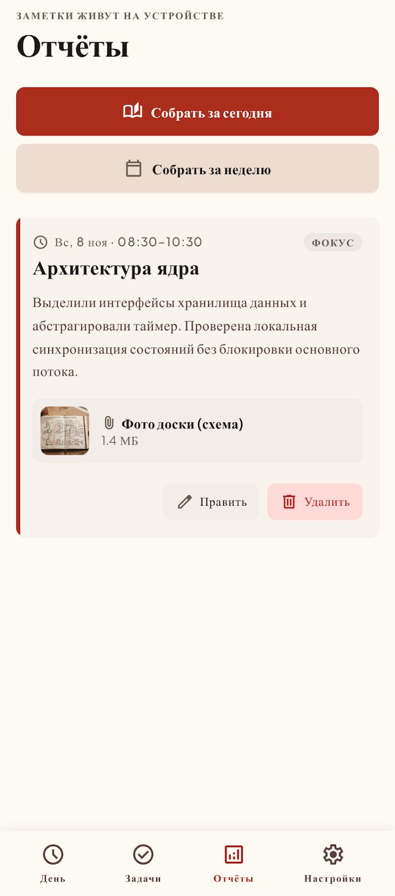
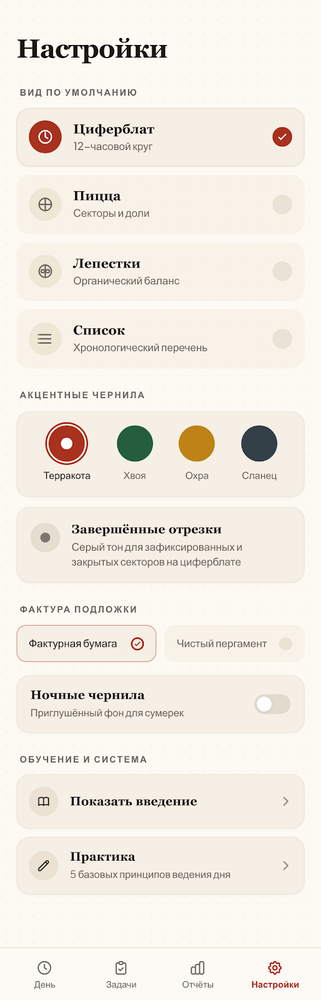
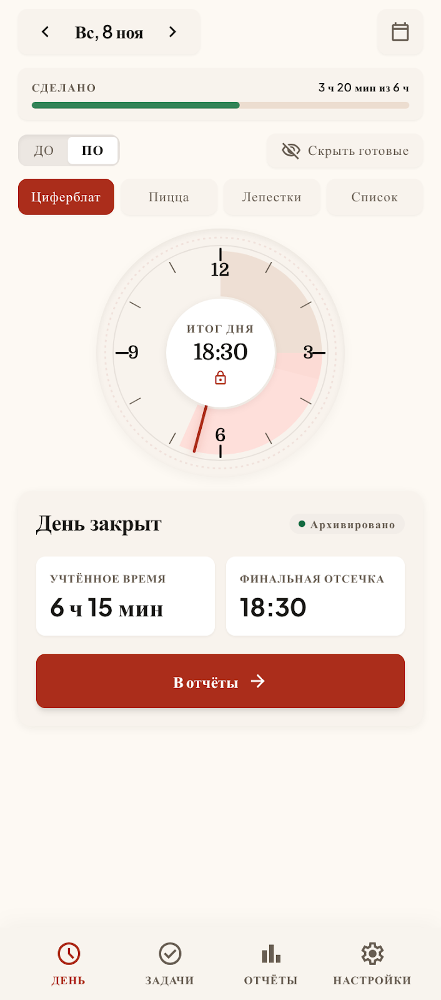
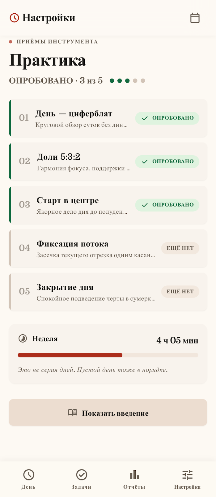

# TimeDial Planner

День, который хочется открыть. Время лежит на круге: утро и вечер — два циферблата по 12 часов, дела — цветные сектора. Коснитесь сектора, прочитайте, нажмите «Старт» и остановитесь ровно там, где остановились вы.

Соберите debug-сборку из этого репозитория и поставьте на телефон. Текущая версия: **1.0.0**.

Коротко, что уже можно попробовать:

- Один день в четырёх видах: **циферблат**, **пицца**, **лепестки** и **список**
- Дела без часов сами занимают свободные минуты: важное **5**, среднее **3**, спокойное **2**
- Проекты, важность, перенос, копия и повтор по дням
- **«Старт»** и **«Пауза»** внутри циферблата: новый отрезок добавляется, закрытый остаётся как был
- Заметка к закрытому отрезку и файл остаются на этом устройстве
- Подложка круга, цвет акцента и цвет готового — в настройках
- Короткое введение, русский и английский, подписи для TalkBack

## Как это выглядит

Ниже — кадры интерфейса. Это макеты экрана: по ним видно, как день ощущается в руке.

Проверьте на телефоне: откройте день, выберите сектор, нажмите «Старт», затем «Пауза» и вернитесь к тому же делу.

### День

Внутри циферблата — «ЖИВОЙ ХРОНО» и текущее время. Круг свободен: выберите дело и начните день одним касанием.



Коснулись сектора — над ним карточка задачи, внутри круга кнопка «Старт». Размеченный отрезок начинается сразу.



Внутри циферблата — «В ПОТОКЕ», время этого захода и «Пауза». Видно, чем вы заняты, и заход можно остановить, сохранив уже прошедшие минуты.


«Пицца» собирает тот же день в сплошные доли. На круге 12, 3, 6 и 9 — сразу видно, куда ушли часы.


«Лепестки» раскладывают дела вокруг центра. Каждое занятие — свой лепесток, день читается с одного взгляда.



Готовое становится спокойным серым сектором, а то, что ещё впереди, остаётся на круге. День собирается вокруг незаконченного.


«Список» показывает день строками: у спорта два интервала, внизу «+ Задача». Удобно добавить дело, когда круг уже заполнен.



### Задачи

Все дела дня в одном месте. «Спланировать цель» — для важного, «без часов» — для того, чему ещё не нужен слот на круге.


Прошедший отрезок закрыт замком и остаётся как был. Двигайте только открытый: конец шагом по 15 минут, новый интервал — одной кнопкой.


Новая задача без часов: название, заметка и доля свободного времени. Важное само займёт больше круга.


### Отчёты и настройки

В «Отчётах» к закрытому отрезку остаётся заметка: заголовок, время и текст на этом устройстве. День можно вспомнить вечером.



Неделя без закрытых отрезков выглядит спокойно: «Закрытых отрезков нет». Собирать пока нечего — и это нормальное начало.


В «Настройках» круг остаётся 12-часовым. Здесь выбирают вид дня, цвет и подложку — и сразу видно, каким будет следующий экран.



### Поток

«Пауза» открывает лист «Где остановился»: короткая заметка и настроение, а прошедший отрезок остаётся на своём месте.


На секторе — «Продолжить с: цифры за четверг». Возвращаетесь к делу с места прошлой остановки.


«День закрыт» собирает часы и последнюю остановку и ведёт в отчёты. Итог дня — на одном экране.



### Практика

Так задумано короткое обучение. Этих экранов в текущей сборке ещё нет: кадры показывают приёмы, с которых хочется начать круг.

Пять коротких приёмов и строка «ОПРОБОВАНО · 3 из 5». Сразу видно, что уже попробовали, и можно открыть следующий.



С нуля тоже спокойно: «0 из 5», каждый приём ещё впереди. Список того, что стоит попробовать в первый день.


Урок читает 12-часовой круг: внутри циферблата «ЖИВОЙ ХРОНО» и время, на кольце 12, 3, 6 и 9. Половина суток становится понятной за один экран.


Дела без точного часа делят свободные минуты: высокая, средняя и низкая важность — 5, 3 и 2. Важное занимает больше круга само.


Урок потока показывает живой заход: внутри циферблата «В ПОТОКЕ», «этот заход» и «Пауза». Остановка открывает «Где остановился».


Неделя — семь столбцов закрытых минут, от понедельника до воскресенья. Пустая среда остаётся в ряду: день без отрезков тоже часть картины.


## Not in v1.0-android (v2)

- Kotlin Multiplatform, iOS, Compose Multiplatform
- Google Calendar / Apple Calendar
- Cloud sync, widgets, publishing the kit

---

## Local database

Room schema changes use `version++` and `fallbackToDestructiveMigration()` only. **There is no `Migration` class.** Installing a build whose schema version changed **wipes the local database** (tasks, blocks, reports). Uninstall or clear app storage. Attachment files under the app files directory are not a Room migration; clearing storage removes those too.

Preferences (view mode, colors, background, onboarding) live in DataStore and are not wiped by a Room schema bump.

---

## Build

Needs **JDK 17+** and an **Android SDK**.

```bat
gradlew.bat :app:assembleDebug
gradlew.bat :app:testDebugUnitTest
```

Debug APK: `app\build\outputs\apk\debug\app-debug.apk` (or `dist\TimeDial-debug.apk` via `build-apk.bat` when that script is present). minSdk 29. First launch can seed a sample day.

## Continuous integration

Every **push** and **pull request** runs the GitHub Actions workflow [`.github/workflows/android.yml`](.github/workflows/android.yml). The job that must be green is **`android`** (workflow name: Android).

That job checks out the repo, sets up **JDK 17**, validates the Gradle wrapper, then runs:

- `:app:testDebugUnitTest`
- `:app:assembleDebug`

The Gradle user-home cache is enabled (`gradle/actions/setup-gradle`, `cache-provider: basic`). The workflow does not use secrets, a signing keystore, or `google-services.json`.

Docs: [docs/TZ.md](docs/TZ.md) · [docs/ROADMAP.md](docs/ROADMAP.md) · [docs/CHANGELOG.md](docs/CHANGELOG.md) · [docs/PLAY_CHECKLIST.md](docs/PLAY_CHECKLIST.md) · [AGENTS.md](AGENTS.md)

---

## License

Source is published as-is for this repository; no SPDX license file yet.
