# TimeDial Planner

Android day planner drawn as a **clock face**, not a list. One day is two 12-hour faces (AM / PM). Tasks are colored sectors; tap a sector for the description.

Current version: **1.0.0** (`v1.0-android`). Product spec: [docs/TZ.md](docs/TZ.md).

---

## What v1.0-android can do

- **DIAL**, **PIZZA**, **PETALS**, and **LIST** for the same day
- Untimed tasks fill leftover minutes (importance **5 : 3 : 2**)
- Projects, importance, move/duplicate, and daily or weekday recurrence
- **Start / Pause** in the center of the dial (new interval only; closed blocks stay)
- Text reports with a **local photo or file** copied into the app files directory
- Dial underlays (none, solid color, three presets). A user photo is a stub
- Settings stored in **DataStore**: default view, accent, completed color, background
- Short onboarding, **English and Russian** from the system locale, TalkBack labels

## Как это выглядит

Кадры ниже — визуальный ориентир интерфейса. Это макеты экрана, а не фотография работающего устройства.

### День

В дырке циферблата видны «ЖИВОЙ ХРОНО» и время, выбран чип «Циферблат», под кольцом пусто: день открыт, сектор ещё не выбран и таймер не запущен.


Над сектором карточка задачи, в центре кнопка «Старт»: так начинают уже размеченный отрезок.


В дырке «В ПОТОКЕ», «этот заход» и «Пауза», чип «Список» виден целиком: текущий заход идёт, и его можно остановить.

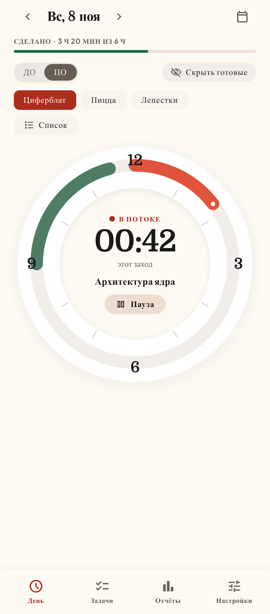

Выбрана «Пицца», на круге цифры 12, 3, 6 и 9: тот же день показан сплошными долями.

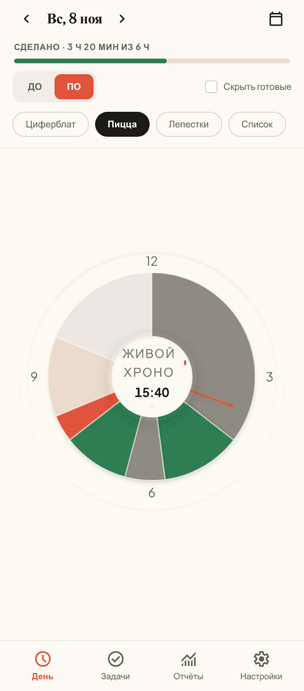

Выбраны «Лепестки»: дела дня лежат отдельными лепестками вокруг центра.


На циферблате серый завершённый сектор и оставшаяся работа: готовое видно серым, незакрытые дела остаются на круге.

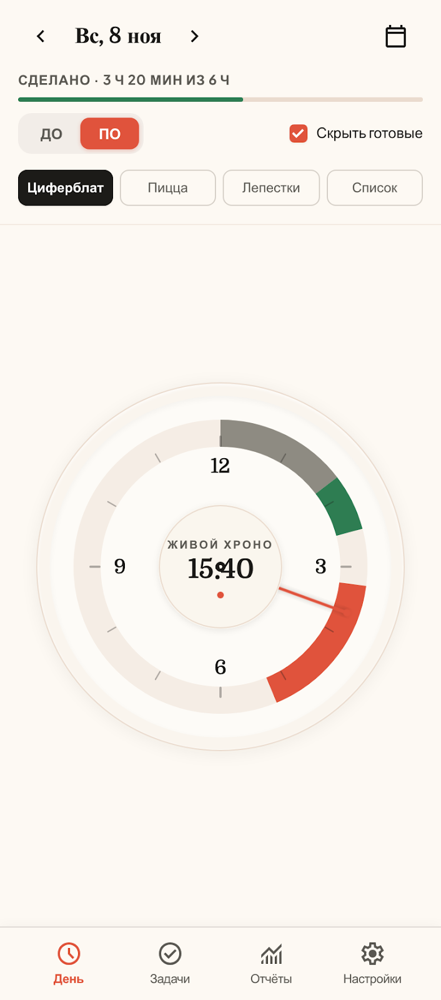

В режиме «Список» у спорта два интервала, внизу кнопка «+ Задача»: день читается строками, новое дело добавляется отсюда.


### Задачи

На вкладке задач видны «Спланировать цель» и записи «без часов»: инвентарь дня, где часть дел ещё не привязана к часам.

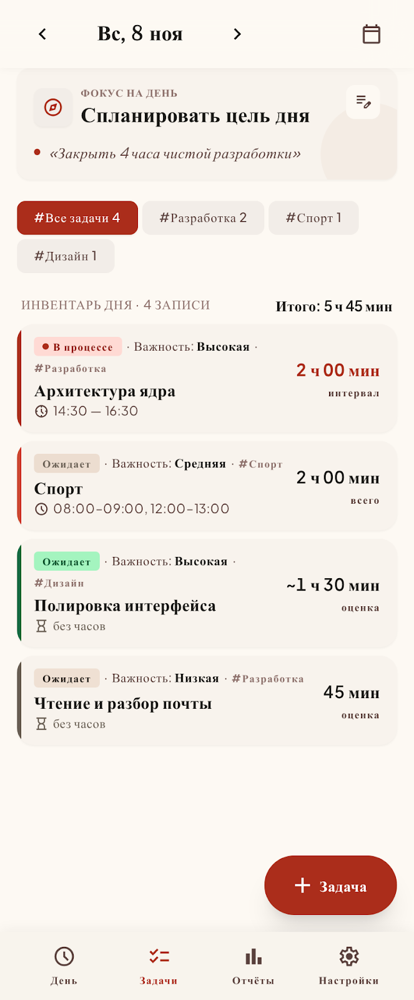

У прошедшего блока замок, подписи «24-ч» нет: закрытый отрезок остаётся как есть, правится только открытый.

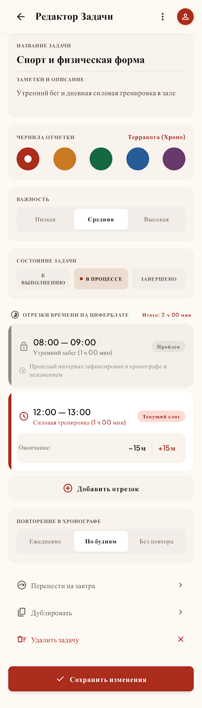

Поля названия и заметки пустые, на карточке «без часов»: новую задачу сохраняют как долю остатка, без слота на круге.

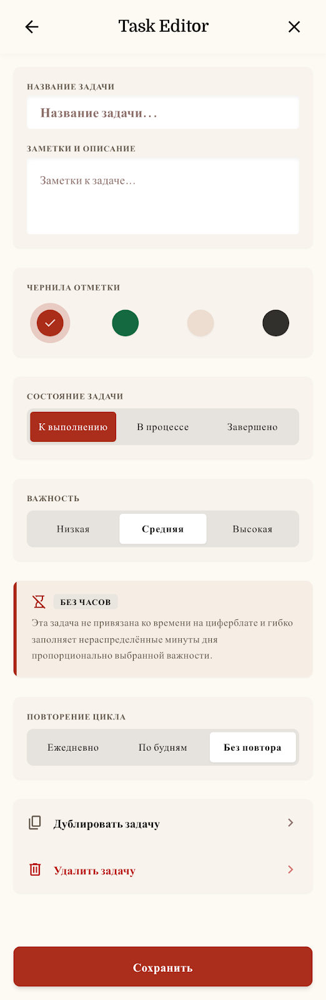

### Отчёты и настройки

Под заголовком «Отчёты» одна заметка, иконки поиска над заголовком нет: к закрытому отрезку можно оставить текст на этом устройстве.


На экране отчётов написано «Закрытых отрезков нет»: неделя без закрытых интервалов — обычное пустое состояние.


У вида «Циферблат» подпись «12-часовой круг», заголовка «Nastrojki» нет: здесь выбирают вид дня, цвет и подложку.


### Поток

Открыт лист «Где остановился»: пауза просит короткую заметку и оставляет прошедший отрезок на месте.

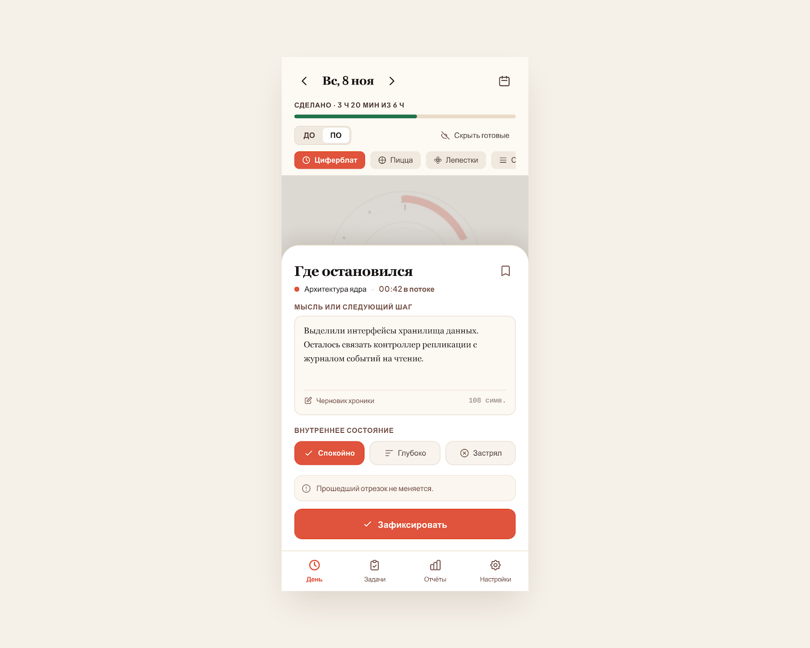

У сектора подпись «Продолжить с: цифры за четверг»: к делу возвращаются с места прошлой остановки.

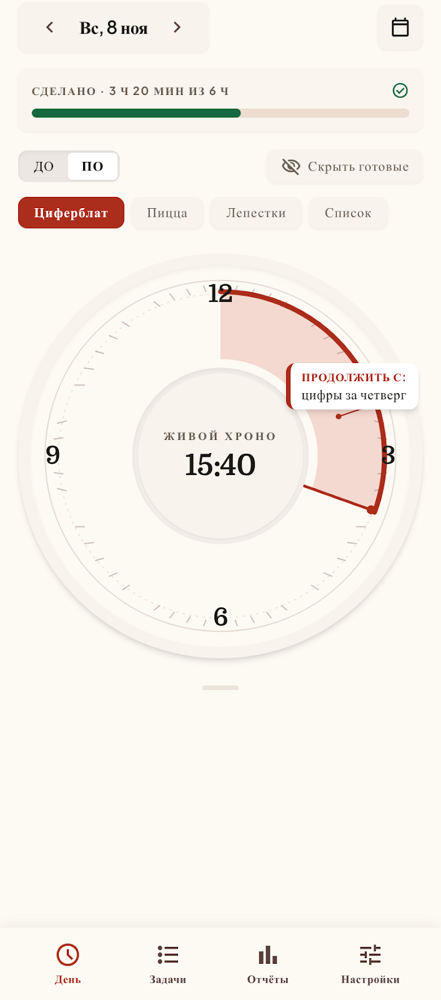

Внизу карточка «День закрыт», строки «Печать №» нет: день сворачивается в итог и ведёт в отчёты.


### Практика

Вкладка «Настройки» открыта на списке «Практика»: видно, какие приёмы уже опробованы.


На той же вкладке практика с нулём опробованных приёмов: обучение ещё не начато.

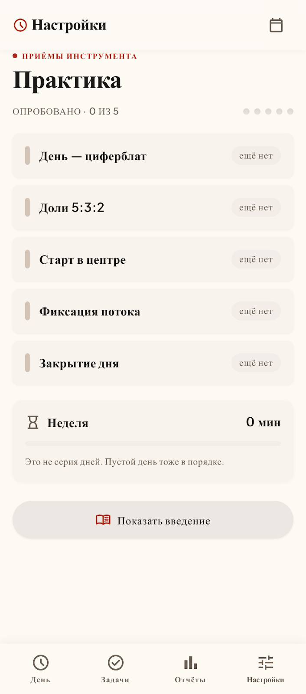

Урок «Чтение 12-часового круга» на вкладке «Настройки»: сектор показывает половину суток, до или после полудня.

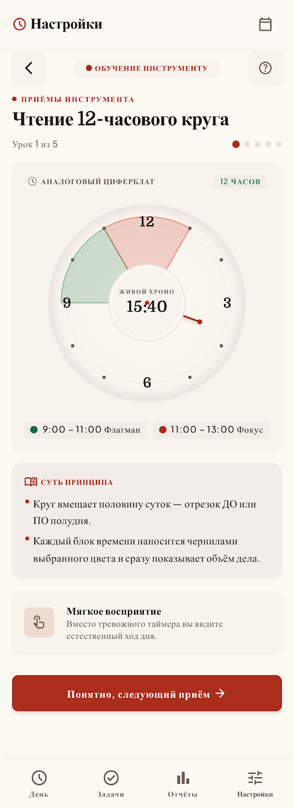

Урок про нераспределённый остаток и доли 5:3:2: дела без точного часа делят свободные минуты по важности.

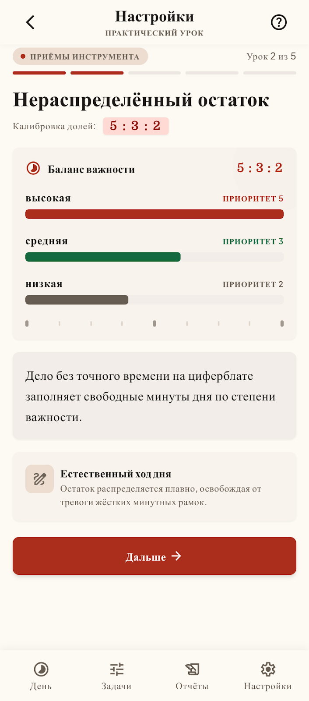

Урок «Вход в рабочий поток» на вкладке «Настройки»: в центре «В ПОТОКЕ», «этот заход» и «Пауза», пауза ведёт к листу «Где остановился».

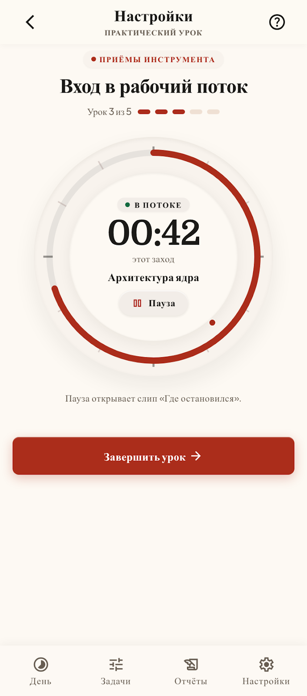

Экран «Неделя» внутри практики на вкладке «Настройки»: столбцы закрытых минут по дням, пустой день остаётся в ряду.

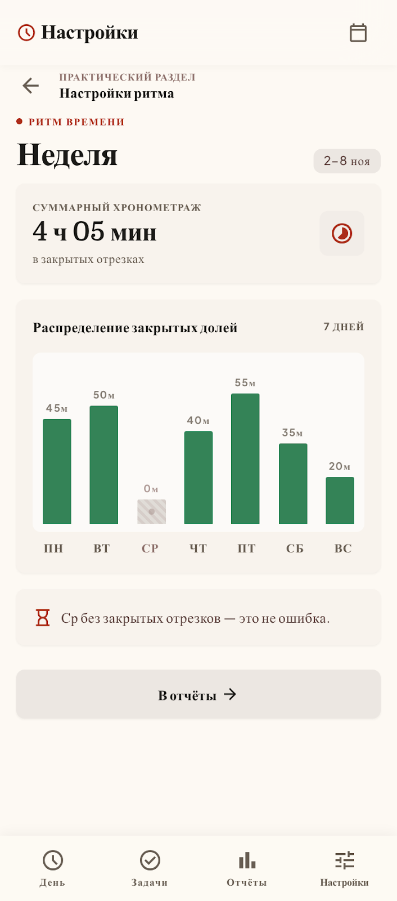

## Not in v1.0-android (v2)

- Kotlin Multiplatform, iOS, Compose Multiplatform
- Google Calendar / Apple Calendar
- Cloud sync, widgets, publishing the kit

---

## Local database

Room schema changes use `version++` and `fallbackToDestructiveMigration()` only. **There is no `Migration` class.** Installing a build whose schema version changed **wipes the local database** (tasks, blocks, reports). Uninstall or clear app storage. Attachment files under the app files directory are not a Room migration; clearing storage removes those too.

Preferences (view mode, colors, background, onboarding) live in DataStore and are not wiped by a Room schema bump.

---

## Build

Needs **JDK 17+** and an **Android SDK**.

```bat
gradlew.bat :app:assembleDebug
gradlew.bat :app:testDebugUnitTest
```

Debug APK: `app\build\outputs\apk\debug\app-debug.apk` (or `dist\TimeDial-debug.apk` via `build-apk.bat` when that script is present). minSdk 29. First launch can seed a sample day.

## Continuous integration

Every **push** and **pull request** runs the GitHub Actions workflow [`.github/workflows/android.yml`](.github/workflows/android.yml). The job that must be green is **`android`** (workflow name: Android).

That job checks out the repo, sets up **JDK 17**, validates the Gradle wrapper, then runs:

- `:app:testDebugUnitTest`
- `:app:assembleDebug`

The Gradle user-home cache is enabled (`gradle/actions/setup-gradle`, `cache-provider: basic`). The workflow does not use secrets, a signing keystore, or `google-services.json`.

Docs: [docs/TZ.md](docs/TZ.md) · [docs/ROADMAP.md](docs/ROADMAP.md) · [docs/CHANGELOG.md](docs/CHANGELOG.md) · [docs/PLAY_CHECKLIST.md](docs/PLAY_CHECKLIST.md) · [AGENTS.md](AGENTS.md)

---

## License

Source is published as-is for this repository; no SPDX license file yet.
