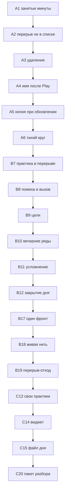

# Дорожная карта улучшений

Шесть недель до живого циферблата уже прошли. Следующая очередь — не новый продукт, а спокойный день, в котором можно начать дело, остановиться, назвать переживание и вечером увидеть его. Миссия «Поток» задаёт направление. То, что уже обещано списку задач, живой сессии и кругу, нельзя ломать.

Канон поведения: [TZ.md](TZ.md). Старый план до v1.0-android: [ROADMAP.md](ROADMAP.md). Первая волна дня (что уже собирали): [ROADMAP_NEXT.md](ROADMAP_NEXT.md). Промпты этой карты, по одному на чат: [PROMPTS_ROADMAP_IMPROVE.md](PROMPTS_ROADMAP_IMPROVE.md). Кадры Stitch под миссию 0.5: [STITCH_MISSION_PROMPTS.md](STITCH_MISSION_PROMPTS.md).

---

## Что уже есть на экране

Пользователь открывает **День**. Круг показывает половину суток: AM до полудня, PM после. Меню вида слева, половины справа. Play в центре начинает заход даже без выбранного дела. Pause закрывает работу и ставит **перерыв**; в отверстии слово «Перерыв» и иконка Play. «Завершить задачу» открывает лист после захода. Повторное нажатие по выбранному сектору снимает выбор.

На вкладке **Задачи** нет песочных строк `#break`. Долгое нажатие отмечает несколько дел, удаление спрашивает. На одно время одного дня второе дело с часами не сохраняется. Незакрытый отрезок можно поправить или убрать; закончившийся — нет.

**Отчёты** показывают день после дел, не поверх захода. В боковом меню есть практики. Стартовый вымышленный день больше не появляется сам.

Это не дыры, а пол: следующие шаги опираются на них.

---

## Как выбирать работу

Каждое улучшение отвечает двум вопросам. Становится ли яснее, какое действие сейчас и какое одно сразу после? Ведёт ли этот шаг переживание дела, а не подгонка?

Рядом с этим улучшение может ставить ближайшее дело, называть переживание без диагноза, углублять внимание, растить умение, чуть усложнять привычное и оставлять круг тихим во время захода.

Не берём в эту карту: клиническую диагностику, автоматическое «вы в потоке», ленту и рейтинги, календарь Google/Apple, другую платформу, физиологию, ключ модели внутри приложения. Кнут тоже не берём: серии, очки, стыд, «ты отстаёшь», красное кольцо, повторный сигнал, пуш, который догоняет неначатый шаг. Минуты захода и один звук на границе шага остаются: это разметка очереди. Пакет разбора человек носит файлом сам; предложения входят только по галочке.

Один шаг — одно изменение. Пока шаг не проверен на устройстве, следующий не трогает те же экраны.

---

## Волна А. Укрепить день

Ближайшие две-три недели. Пользователь должен доверять тому, что уже нарисовано.

### 1. Одно время — одно дело и с Play

Сейчас редактор не даёт сохранить два дела на одни часы. Play и пауза всё ещё могут положить работу на уже занятые минуты. Нужно, чтобы и с круга нельзя было занять чужой отрезок. Безвременные дела по-прежнему делят свободное.

Проверка: завести дело 09:00–10:00, нажать Play в 09:15. Заход либо встаёт в свободное, либо приложение ясно отказывается. Старый отрезок не двигается.

### 2. Перерыв живёт на круге, не в списке

Песочный клин виден на циферблате. В «Задачах» его нет, фильтра `#break` нет. Удаление работы уносит и её перерывы. Кнопка «Завершить задачу» не зависает после удаления.

Проверка: Play → Pause → вкладка «Задачи». Видно только работу. Удалить работу — перерыв с круга исчез, «Завершить задачу» нет.

### 3. Удаление одним языком

На дне вопрос «Удалить это дело?», основная кнопка «Оставить». В списке то же спокойствие для одного и для нескольких: подтверждение, без красной заливки. Отмена оставляет отметки, но ничего не стирает.

Проверка: отметить два дела и соседнее не трогать. «Оставить» — все три на месте. «Удалить» — два исчезли, третье на круге как было.

### 4. Безымянный заход получает имя без давления

Play без названия допустим. При завершении имя спрашивается. Пустое имя не блокирует сохранение оценок: подставляется спокойное «Новое дело», лист можно открыть снова и поправить.

Проверка: Play без имени, завершить с пустым названием, увидеть дело в дне, открыть его и переименовать. Закрытые отрезки на месте.

### 5. День не исчезает при обновлении приложения

Сейчас смена внутренней схемы может стереть локальные записи. Пользователь должен либо явно согласиться на сброс, либо получить копию дня на устройство до обновления. Облака нет.

Проверка: записать два дела, смоделировать обновление. Либо день на месте, либо перед сбросом есть файл копии, который можно вернуть.

### 6. Тихий круг

Во время захода нет сводки дня, нет курса поверх работы, нет слов «Старт» и «Пауза» на кнопках. TalkBack называет Play, Pause и половины суток. Повторный тап снимает выбор.

Проверка: начать заход, провести пальцем TalkBack по центру и по AM/PM. На круге нет вечерних цифр. Второй тап по сектору снимает облако.

---

## Волна Б. День как вход в поток

Три-четыре недели после волны А. Не новые вкладки, а то, что происходит вокруг захода.

### 7. Практика в перерыве

Три короткие практики уже есть в меню. Их предлагают **в перерыве** или **перед делом**, которое человек сам отметил как требующее внимания. Во время открытой работы предложение не всплывает. На экране практики сказано, что это проба, не лечение, и на какое исследование она опирается.

Проверка: Play → Pause, увидеть предложение практики. Снова Play — предложение скрыто. Открыть практику из меню в любой момент, кроме идущей работы на круге.

### 8. Помеха и вызов

В листе завершения одна пометка: вызов или помеха. Если выбрана помеха, рядом тихая строка: как переформулировать её в вызов. Её можно оставить пустой. Чекбокса «я в потоке» нет.

Проверка: завершить дело, отметить «помеха», вписать переформулировку, сохранить. Вечером в отчётах видна эта пометка и текст. Соседнее дело без пометки не меняется.

### 9. Цели до круга

Одна главная цель и несколько промежуточных живут списком, не схемой на круге во время захода. Дело можно привязать к промежуточной. Следующее дело после завершения садится в ту же промежуточную, если она была.

Проверка: завести промежуточную цель, привязать дело, завершить и создать следующее. Второе дело в той же цели. Во время захода на круге цели не рисуются.

### 10. Вечер без «балла потока»

Отчёты показывают отдельные ряды: состояния 1–10, сколько вызовов и помех, навык, сколько дел начато. Рядом с числами ясно, что это самоотчёт. Пустой день — нули и пустые строки, без тревоги. Короткая форма потока, если её заполняли, стоит **рядом**, не вместо шкалы 1–10, и не называется диагнозом.

Проверка: два завершения с разными оценками и разными пометками. Отчёты совпадают с листом. Идущий заход не показывает эту сводку на круге.

### 11. Усложнение привычного

Если несколько похожих завершений подряд показывают высокий навык и низкую вовлечённость, приложение **один раз** предлагает чуть сузить следующее такое дело. Можно пропустить. Наград за согласие нет. Закрытые отрезки и уже сохранённые оценки не переписываются.

Проверка: три похожих завершения с навыком 8+ и вовлечённостью 4−. Появляется предложение. Пропуск — больше не спрашивает про эти три. Согласие — вчерашние отрезки на месте.

### 12. Мягкое закрытие дня

Вечером можно закрыть день одной карточкой: сколько минут уже записано. Карточка не блокирует Play и новые дела. «К отчётам» открывает вкладку и не создаёт лишний отчёт. Напоминание — только если пользователь сам включил его в настройках, без канала тревоги.

Проверка: закрыть день с нулём минут — спокойный текст. Открыть отчёты с карточки. Начать дело после закрытия — круг принимает заход.

---

## Волна Б2. Ремесло внимания

После того как волна Б держит тихий заход. Это очередь из миссии §2.1 и ремесло §6.3 на уже собранном дне. Новых вкладок нет. Биографий, шагомера, второго блокнота и кнута нет.

Круг по-прежнему показывает все дела половины суток. Меняется только то, с чего день входит в работу и чем встречает возврат.

### 17. Один фронт дня

На видимом дне можно отметить одно дело фронтом. Пока заход не идёт, отверстие называет его, и Play начинает его. Старт другого дела переносит фронт на это дело. Второй открытый заход не появляется. Во время захода цели и сводка на круг не встают.

Проверка: отметить «Письмо» фронтом, увидеть его в отверстии, начать «Звонок». Фронт теперь «Звонок», у «Письма» открытого отрезка нет. Повторный Play на идущем деле второй отрезок не дописывает.

### 18. Живая нить

У дела одна строка «что дальше». Она видна, когда дело выбрано и заход не открыт. Play её снимает. Пауза лист не открывает: строку пишут заранее или правят на выбранном деле в покое. Пустая строка оставляет дело без нити. Закрытые отрезки от строки не меняются.

Проверка: записать «со второго абзаца», уйти на список и вернуться — строка на месте. Play — строки нет, открыт один новый отрезок. Пауза показывает перерыв и не спрашивает строку.

### 19. Перерыв как отход

В отверстии остаётся «Перерыв» и тихая строка, что можно отойти от экрана. Практики по-прежнему в боковом меню и только когда работа не идёт. Приложение не считает шаги и не хвалит за прогулку.

Проверка: Pause. В отверстии «Перерыв» и строка про отход. Меню предлагает практику. Play снова прячет и практику на круге, и эту строку под работой.

---

## Волна В. Устройство и доверие

Позже, когда волны А, Б и Б2 держатся неделю без поломки дня.

### 13. Свои практики только здесь

Человек добавляет свой короткий курс названием на устройстве. Публикации, ленты и скачивания чужого нет.

### 14. Виджет «сейчас»

На рабочем столе видно, идёт ли заход или перерыв, без открытия приложения. Нажатие открывает день. Виджет не считает углы сам.

### 15. Копия дня файлом

Выгрузить сегодняшний день текстом или файлом на устройство и вернуть его. Облака нет.

### 20. Пакет разбора без сети

После того как копия дня файлом уже работает. Человек выбирает дни и поля, забирает пакет разбора и относит его любому агенту сам. Приложение ничего не отправляет. Обратно — файл предложений по известной схеме. На экране карточки с галочками. «Применить» пишет только отмеченное. «Отклонить» запоминается. Закрытый отрезок, неизвестная операция и SQL не входят в день.

Проверка: выгрузить две недели без свободного текста. Вернуть два предложения: совет на деле и разбиение. Отметить совет, отклонить разбиение. Совет виден на деле. Новых дел нет. Закрытые минуты те же. Повтор отклонённого разбиения не встаёт как новое.

### 16. Другой горизонт

Календарь, iOS, общее планирование, EEG и HRV — не эта карта. К ним переходят отдельным решением, не смешивая с волнами А–В.

---

## Сценарий проверки всей волны А

Пустой день. Play. Pause. На круге перерыв, в списке его нет. Создать дело на 10:00–11:00 и попытаться поставить второе на те же часы — отказ. Отметить два лишних дела, удалить, третье на месте. Завершить безымянный заход, дать имя позже. Повторный тап снимает выбор.

Если этот круг проходит на телефоне, волну А можно считать готовой и брать волну Б.

Отдельный круг волны Б2: фронт «Письмо», старт другого дела переносит фронт, строка «что дальше» переживает уход и снимается следующим Play, пауза не открывает лист и пишет, что можно отойти.

---

# Техническое приложение

## Соответствие миссии

| Шаг | Раздел миссии | Зачем |
|---|---|---|
| Одно время | принцип 1, шаг «а» | День читается, дела не накрывают друг друга |
| Перерыв только на круге | принцип 7, §7.4 | Восстановление видно в момент, не как вторая работа в списке |
| Удаление | принцип 6 | Переживание стирается целиком и локально |
| Имя после Play | принцип 1 | Порог старта низкий |
| Сохранение при обновлении | принцип 6 | Записи принадлежат пользователю |
| Тихий круг | принцип 7, §8.3 | Во время захода только проксимальное |
| Практика в перерыве | шаг «в», §7 | Настройка внимания не во время работы |
| Помеха и вызов | §6.2, принцип 4 | Различение стресса без диагноза |
| Цели | шаг «а», §10 | Декомпозиция до круга |
| Вечерние ряды | шаг «б», §8.1, принцип 7 | Измеримость после дел |
| Усложнение | шаг «д», принцип 5 | Рост без наград |
| Закрытие дня | принцип 7 | Аналитика на фазе восстановления |
| Один фронт | §6.3, принцип 11 | Много секторов, один вход в работу |
| Живая нить | §6.3, принцип 12 | Возврат одной строкой, пауза без листа |
| Перерыв как отход | §6.3, шаг «в» | Вынашивание без шагомера |
| Свои практики | принцип 9 и 10 | Курс, не лента |
| Виджет | принцип 7 | Взгляд без входа в аналитику |
| Копия файлом | принцип 6 | Приватность на устройстве |
| Пакет разбора | §6.5, принцип 15 | Чужой взгляд без ключа и без автоприменения |

## Файлы

| Путь | Зачем для этой карты |
|---|---|
| `docs/ROADMAP_IMPROVE.md` | Этот план |
| `docs/PROMPTS_ROADMAP_IMPROVE.md` | Промпт на каждый шаг |
| `docs/TZ.md` | Канон круга, leftover, неизменяемость |
| `spec/mission.md` | Шаги а–д, принципы 1–10 |
| `openspec/specs/task-list/` | Список, периоды, удаление |
| `openspec/specs/flow-session/` | Play, пауза, перерыв, лист |
| `openspec/specs/day-dial/` | Геометрия, подписи, выбор сектора |
| `openspec/specs/visible-day/` | Сегодня и полночь |
| `openspec/specs/day-stats/` | Вечерние ряды |
| `openspec/specs/goals/` | Главная и промежуточные |
| `openspec/specs/learning-library/` | Три практики, без публикации |
| `app/.../ui/day/DayViewModel.kt` | Play, Pause, Finish, delete |
| `app/.../ui/task/TasksViewModel.kt` | Пересечение периодов, multi-select |
| `app/.../kit/core/TaskDraftValidator.kt` | Отказ пересечения при сохранении |
| `app/.../kit/core/BreakSession.kt` | Песочный клин |
| `app/.../data/` | Room, destructive bump |

## Изменения OpenSpec

Каждый пункт волны — один `/openspec-propose`. Архив после `:app:testDebugUnitTest`.

| Порядок | Change | Спеки |
|---|---|---|
| A1 | `play-respects-occupied-minutes` | `flow-session`, `task-list` |
| A2 | проверить `unique-editable-periods` и `delete-clears-orphan-break` на устройстве | уже в `task-list` / `flow-session` |
| A3 | `delete-dialog-matches-day-and-list` | `task-list` |
| A4 | уже близко к `save-completion-for-edit`; добить пустое имя | `flow-session` |
| A5 | `preserve-day-across-schema-bump` | новая `backup` или правка хранения; **не** класс Room `Migration`, пока не решено явно |
| A6 | полировка TalkBack и тишины круга | `day-dial`, `flow-session` |
| B7 | `practice-offer-on-break` | `learning-library`, `flow-session` |
| B8 | `hindrance-to-challenge-line` | `flow-session` |
| B9 | полировка `goals` без схемы на круге | `goals`, `task-list` |
| B10 | подписи самоотчёта в отчётах | `day-stats` |
| B11 | уже есть nudge; не ломать closed blocks | `task-list` |
| B12 | day-close без lock | `flow-session` |
| B17 | `one-daily-front` | `flow-session`, `day-dial` |
| B18 | `living-thread-line` | `flow-session`; пауза по-прежнему не открывает лист |
| B19 | `break-is-a-step-away` | `flow-session`; курс остаётся в меню |
| C13 | local custom course only | `learning-library` |
| C14 | Glance widget | новая спека, kit.render не тянуть в виджет |
| C15 | export/import day file | приватность, без сети |
| C20 | `review-packet-offline` | новая спека `review-packet`; закрытый набор операций; закрытые блоки не трогать |

## Контракты, которые легко сломать

- 0° = 12 часов, по часовой, 1440 минут = 360°.
- Закрытый `TimeBlock` не редактируется. Play и Pause только дописывают.
- Скрыть готовое на круге перекладывает остаток. Список только фильтрует. Веса 5:3:2 не меняются этими шагами.
- Поворот сцены не переписывает минуты дел.
- `kit.render` не знает Room и экраны. UI не считает углы сам.
- Нет класса Room `Migration`, пока отдельное решение не отменит destructive bump.
- Во время открытого рабочего интервала курс и вечерняя сводка не на круге.
- Фронт дня один. Старт другого дела переносит фронт и не открывает второй заход.
- Строка «что дальше» не лежит внутри закрытого блока и снимается следующим стартом.
- Пакет разбора не вызывает модель. Применяются только отмеченные предложения известного типа. Закрытый отрезок из файла не двигается.
- Оценки живут на деле, не внутри закрытого блока.

## Методы

Пересечение при сохранении уже в `TaskDraftValidator.validate(..., occupying, nowMinute)`. Волна A1 обязана провести ту же проверку на пути Play в `DayViewModel`, не дублируя арифметику в UI.

`BreakSession.isBreak` скрывает клинья в `TasksUiState.visibleTasks`. Удаление работы чистит `BreakSession.wedgesFor`.

`TasksUiIntent.ToggleTaskSelection` / `RequestDeleteSelected` — множественное удаление. Диалог дня остаётся `DayUiIntent.RequestDelete` с «Оставить».

Схема Room: `fallbackToDestructiveMigration()`. A5 не добавляет `Migration`, пока канон TZ это запрещает; шаг про копию файла, не про эволюцию схемы.

## Блок-схема

