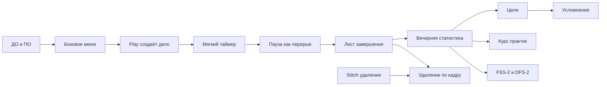

# Следующие шаги дня

> Историческая очередь первой волны дня. Актуальный план улучшений: [ROADMAP_IMPROVE.md](ROADMAP_IMPROVE.md).

Как день будет ощущаться после этой очереди и какие обещания миссии она закрывает. Каждый шаг — отдельное изменение: сначала предложение, потом сборка, потом архив. Пока тесты красные, шаг не закрывают.

Миссия — зачем существует «Поток». Эта очередь собирает день, в котором уже можно войти в работу, остановиться, назвать переживание и увидеть его вечером. Иерархия целей, рост сложности и курс практик идут следующей волной: без записанного дня им не на что опереться.

Канон уже обещанного поведения: список задач, живая сессия, циферблат. Библиотека туториалов в текущей сборке отсутствует и появляется только шагом второй волны.

## Что увидит пользователь

### 1. ДО и ПО

Над кругом вместо AM и PM две половины суток: **ДО** и **ПО**.

ДО — от полуночи до полудня. ПО — от полудня до полуночи. Часы на круге те же: 12 сверху, по часовой. Переключение половины не двигает уже записанные дела.

Это порог чтения дня: половина суток называется по-русски, и день можно начать, не расшифровывая AM и PM. Отдельной механики потока здесь нет.

Проверка: открыть день утром и после полудня, переключить ДО и ПО, убедиться, что сектора остались на своих часах. TalkBack читает «до полудня» и «после полудня».

### 2. Боковое меню

«Внешний вид» и «Скрыть готовое» уходят с лица дня в боковую панель. Круг остаётся главным. Вид (циферблат, пицца, лепестки, список), акцент, цвет готового и подложка живут в этой панели. «Скрыть готовое» по-прежнему заново раскладывает оставшуюся работу на круге. В списке готовые строки просто исчезают, времена остальных не плывут.

Во время захода на круге остаётся только ближайшее: имя дела и время этого захода. Оформление и сводка готового не стоят поверх погружения.

Проверка: открыть панель, сменить вид и подложку, скрыть готовое на круге и в списке. Панель и экран настроек пишут одно и то же оформление.

### 3. Play без выбранного дела

Если на круге ничего не выбрано и нажата кнопка Play, появляется новое дело и сразу начинается заход. Прошедшие отрезки других дел не двигаются. Повторное Play на уже идущем деле ничего не дописывает.

Название можно не вводить в этот момент. Если его нет, оно спросится при завершении. Так элементарное действие — нажать Play — уже становится делом дня.

Проверка: на пустом месте нажать Play, увидеть новый открытый заход, нажать Play ещё раз и убедиться, что второй отрезок не появился.

### 4. Мягкий таймер и один звук

Play задаёт длительность этого захода. Шаг — 15 минут. Если у дела уже есть конец на круге, предлагается остаток до этого конца. Если конца нет, предлагается 25 минут, и это можно изменить до старта.

На круге во время захода виден только этот заход, без сводки дня. Когда время вышло, звучит один короткий сигнал, и отрезок закрывается на этой минуте. Сигнал не повторяется и не окрашивает круг в тревожный цвет. Пока нет живого признака потока, таймер не укорачивается и не растягивается сам: ослабление давления при признаках потока — отдельный шаг после того, как появится сигнал, кроме самоотчёта в конце.

Проверка: поставить 15 минут, дождаться конца (или сдвинуть часы в тесте), услышать один сигнал и увидеть закрытый отрезок. Во время захода на круге нет оценок и графиков.

### 5. Пауза ставит перерыв

«Пауза» закрывает рабочий отрезок и начинает перерыв. На экране появляется **Завершить задачу**. Лист «где остановился» с этой кнопки больше не открывается: заметка, различение помехи и вызова и оценка переезжают в завершение.

Перерыв — место восстановления, не вторая работа. Play во время перерыва заканчивает перерыв и дописывает новый рабочий отрезок того же дела. Перерыв не переписывает уже закрытую работу.

Проверка: начать заход, нажать «Пауза», увидеть перерыв и кнопку «Завершить задачу», затем Play и убедиться, что старый отрезок на месте, а новый начался после перерыва.

### 6. Завершить задачу

Кнопка открывает лист уже после захода, когда круг больше не в работе. В нём:

- название следующего дела — ближайшая промежуточная цель;
- если у текущего дела ещё нет названия — сначала его название;
- вовлечённость, шкала 1–10, с подписью «самоотчёт, не клиническая шкала»;
- улучшение навыка, шкала 1–10 и короткая строка, что стало легче;
- что мешало: одна пометка «вызов» или «помеха» и свободный текст; для помехи — необязательная строка, как переформулировать её в вызов;
- статус: выполнено или нет; если нет — какой прогресс уже есть, свободный текст; прогресс ценен и без финала;
- состояние после дела, шкала 1–10, тоже с подписью самоотчёта.

Пустую оценку состояния отправить нельзя. Вовлечённость и навык тоже обязательны. Текст помехи и строку переформулировки можно оставить пустыми. Чекбокса «я в потоке» на листе нет: состояние — число на непрерывной шкале.

Шкалы 1–10 в этом шаге — поведенческий самоотчёт. Они не называются FSS-2 и не обещают девять измерений потока. Валидированная шкала — следующая волна.

После отправки текущее дело получает статус и оценки. Оценки и текст мыслей остаются на этом устройстве. Следующее дело появляется в дне без открытого захода. Закрытые отрезки остаются как были. Пустое имя следующего дела значит, что следующее дело не создаётся, а оценки текущего всё равно сохраняются.

Проверка: завершить безымянное дело, задать имя ему и имя следующего, отметить «помеха», поставить состояние 7, увидеть оба дела. Попытаться отправить лист без состояния и остаться на листе.

### 7. Статистика вечером

В отчётах, после дел, не на круге во время захода. Числа показываются по отдельности, одним «баллом потока» не схлопываются:

- состояния за день — оценки 1–10 по завершённым делам;
- помехи и вызовы — сколько завершений с каждой пометкой и сами строки;
- улучшение навыков — средняя оценка 1–10 и строки «что стало легче»;
- сколько дел начато за день.

Рядом с каждой оценкой видна подпись, что это самоотчёт. Пустой день показывает нули и пустые строки, без предупреждения. Тексты мыслей из отчёта не уходят с устройства.

Проверка: завершить два дела с разными оценками и разными пометками «вызов» и «помеха», открыть отчёты этого дня, сверить числа с листом. Открыть день с идущим заходом и не увидеть эту сводку на круге.

### 8. Удаление

Сначала кадры в Google Stitch по промпту [STITCH_DAY_NEXT_PROMPT.md](STITCH_DAY_NEXT_PROMPT.md), потом сборка. Пока кадра удаления нет, диалог удаления не перерисовывают.

На кадре: день, выбранное дело, явный вопрос с названием дела, подтверждение и отмена. Тон бумаги тот же, без красной тревоги.

После кадров удаление убирает дело, его отрезки и записанные к нему оценки с этого устройства. Чужие дела не двигаются. Подтверждение обязательно. Так переживания остаются у пользователя: он может стереть запись целиком.

Проверка: удалить дело с двумя отрезками, увидеть, что оба исчезли, соседнее дело на месте. Отмена оставляет дело.

## В каком порядке

Дизайн удаления начинают сразу и не ждут статистики. Сборку удаления включают только когда кадр уже лежит в наборе. Остальное идёт сверху вниз: подписи, меню, Play, таймер, перерыв, лист завершения, отчёты.

Пока шаг не заархивирован, следующий не начинает править те же экраны. Готовый промпт на каждый шаг: [PROMPTS_ROADMAP_NEXT.md](PROMPTS_ROADMAP_NEXT.md).

## Вторая волна, когда день уже пишется

Эти шаги миссия относит к направлению продукта. Их не начинают, пока лист завершения и вечерние отчёты не заархивированы: иначе некуда класть цель, сложность и практику.

### Главная цель и промежуточные

У дня появляется одна главная цель и несколько промежуточных. Дело можно привязать к промежуточной. Следующее дело с листа завершения по умолчанию садится в ту же промежуточную цель. Цели видны списком, не схемой на круге во время захода.

### Усложнение, когда дело стало привычным

Если несколько завершений подряд показывают низкую вовлечённость при уже высоком навыке, приложение один раз предлагает чуть усложнить следующее похожее дело: уже шаг, явное требование, более узкий результат. Предложение можно пропустить. Награды и серии за согласие не даются.

### Короткий курс перед сложным делом

Три встроенные практики: очистка ума Heartfulness на 3–5 минут, йога-пауза на 2–3 минуты, микро-цигун на 1–2 минуты. Это курс со шагами и отметкой прохождения, не график. Практику можно пройти снова. Каждое прохождение остаётся в истории и позже может кормить метрику усложнения.

Практика предлагается перед делом, которое пользователь сам отметил как требующее концентрации, или в перерыве. Во время открытого захода предложение не всплывает. На экране практики сказано, что это проба, не лечение, и указано, на какое исследование она опирается.

Свои уроки, публикация, скачивание и удаление чужих уроков — отдельный шаг после трёх встроенных. Ленты, лайков и рейтинга в нём нет.

### Валидированный самоотчёт

Когда поведенческих шкал 1–10 уже достаточно, чтобы день не пустел, самоотчёт состояния дополняется короткой формой FSS-2 или FShortS. Рядом остаётся прежняя шкала 1–10 как прокси. В онбординге — короткий DFS-2, чтобы ожидания от потока не путались с каждым заходом. Пока формы нет, отчёты не называют число 1–10 «баллом потока».

Физиология (EEG, HRV) в эти волны не входит. Модель оценок не должна мешать подключить её позже отдельным источником рядом с самоотчётом.

## Что в эти две волны не входит

Клиническая диагностика и обещание вылечить тревогу. Автоматическое решение «пользователь в потоке» без его отметки. Очки, серии, лента и соревнование. Обмен туториалами раньше, чем на устройстве есть три встроенные практики и повторное прохождение.

---

# Техническое приложение

## Соответствие миссии

| Шаг | Раздел миссии | Что именно закрывает шаг |
|---|---|---|
| ДО / ПО | принцип 1 | Порог чтения дня на родном языке |
| Боковое меню | принцип 7, §8.3 | С круга уходит всё, кроме проксимального захода |
| Play без выбора | принцип 1, шаг «а» в зачатке | Дело рождается из одного действия |
| Мягкий таймер | §8.3, принцип 7 | Дозированное давление одного захода, один сигнал |
| Перерыв | §7.4, принцип 7 | Восстановление отделено от работы; место для будущей практики |
| Лист завершения | шаги «а», «б», «г», §6.1, §6.2, §8.1, принципы 2, 3, 4, 6, 8 | Следующая цель, прокси-шкалы, навык, вызов/помеха, состояние как континуум |
| Вечерняя статистика | шаг «б», принцип 7, §11 | Отдельные ряды самоотчёта после дел |
| Удаление | принцип 6 | Запись переживания стирается целиком и локально |
| Вторая волна: цели | шаг «а», §10 | Главная цель → промежуточные → дела |
| Вторая волна: усложнение | шаг «д», принцип 5, §11 | Предложение повысить сложность при привыкании |
| Вторая волна: курс | шаг «в», §7, принципы 9 и 10 | Три практики как курс; авторские уроки позже |
| Вторая волна: FSS-2 / DFS-2 | §8.1, принцип 3 | Валидированный самоотчёт рядом с прокси |

Лист завершения и отчёты обязаны в тексте интерфейса называть шкалы 1–10 поведенческим прокси. Имя FSS-2 появляется только в шаге валидированного самоотчёта.

## Файлы

| Путь | Зачем |
|---|---|
| `docs/ROADMAP_NEXT.md` | Этот план |
| `docs/PROMPTS_ROADMAP_NEXT.md` | Отдельный промпт реализации на каждый шаг |
| `spec/mission.md` | Шаги а–д, §6–§11, mission-fit |
| `openspec/specs/day-dial/` | Подписи ДО/ПО и боковое меню не ломают геометрию |
| `openspec/specs/task-list/` | Play без выбора, название, удаление |
| `openspec/specs/flow-session/` | Таймер, перерыв, лист завершения |
| `openspec/specs/learning-library/` | Курс второй волны обновляет эту спеку; до него библиотеки нет |
| `app/.../ui/day/AmPmRow.kt` | Сейчас рисует AM/PM из `dial_am` / `dial_pm` |
| `app/.../ui/day/ViewModeRow.kt` | Сейчас держит «Скрыть готовое» на лице дня |
| `app/.../ui/day/DayViewModel.kt` | Старт требует выбранное дело; пауза открывает лист |
| `app/.../ui/stats/` | Куда ляжет вечерняя статистика |
| `docs/STITCH_DAY_NEXT_PROMPT.md` | Промпт шести кадров, включая удаление |
| `stitch_timedial_planner_ui_kit/` | PNG этих кадров до правки диалога |

## Изменения OpenSpec

Каждое имя — один `/opsx-propose`. В предложении указан раздел миссии из таблицы выше. Архив после `:app:testDebugUnitTest`.

| Порядок | Change | Спеки | Сборка |
|---|---|---|---|
| 0, параллельно | `stitch-delete-task` | нет дельты поведения, `skip_specs: true` | только кадры, Kotlin не трогать |
| 1 | `rename-half-labels-do-po` | `day-dial` | строки `dial_am` / `dial_pm` и contentDescription. `DialHalf.AM` / `PM` не переименовывать |
| 2 | `day-side-menu` | `day-dial` | панель; hide-completed по-прежнему reflow на круге и фильтр в списке |
| 3 | `play-creates-task` | `task-list`, `flow-session` | Play без выбора создаёт дело и дописывает открытый интервал |
| 4 | `play-timer-chime` | `flow-session` | длительность шагом 15 минут, один звук, интервал закрывается |
| 5 | `pause-sets-break` | `flow-session` | пауза закрывает работу и начинает перерыв; Play дописывает работу |
| 6 | `complete-task-sheet` | `flow-session`, `task-list` | прокси-шкалы, вызов/помеха, следующее дело |
| 7 | `day-state-stats` | новая `day-stats` | отчёты читают сохранённые оценки по отдельности |
| 8 | `delete-task-from-stitch` | `task-list` | только после PNG в ките |
| 9 | `goal-hierarchy` | новая `goals`, правка `task-list` | главная цель и промежуточные |
| 10 | `difficulty-nudge` | `task-list`, `day-stats` | одно предложение усложнить, его можно пропустить |
| 11 | `built-in-practice-course` | `learning-library` | три практики, повтор, чек-поинты, без публикации |
| 12 | `validated-flow-scales` | `flow-session`, `day-stats` | FSS-2 или FShortS и DFS-2 рядом с прокси |

## Контракты, которые легко сломать

- 0° = 12 часов, по часовой, 1440 минут = 360°. ДО/ПО меняют подпись половины, не угол.
- Закрытый интервал не редактируется. Play и пауза только дописывают.
- Скрыть готовое на круге перекладывает остаток. Список только фильтрует. Веса 5:3:2 не меняются в этих шагах.
- Поворот сцены не переписывает время дел.
- Аналитика шага 7 и курс шага 11 не рисуются поверх идущего захода.
- Оценки листа хранятся на деле, не внутри закрытого интервала. Удаление дела забирает и оценки.
- Спека `learning-library` до шага 11 фиксирует отсутствие курса. Шаг 11 обновляет её дельтой, а не правкой файла спеки руками.

## Методы

Старт без выбора сегодня обрывается в `DayViewModel.startTimer`: нет `selectedTask` — возврат. Дельта `play-creates-task` обязана описать новое поведение до правки этого метода.

Пауза сегодня вызывает `TaskTimer.pause` и открывает `pauseSlipOpen`. Дельта `pause-sets-break` заменяет лист остановки на перерыв и кнопку завершения.

Звук окончания — один короткий эффект в приложении, без канала уведомлений в этом шаге. Если экран погашен, сигнал этого шага не обещается. Адаптивное ослабление таймера при «признаках потока» не входит в `play-timer-chime`: живого признака во время захода ещё нет.

Шкалы вовлечённости, навыка и состояния — целые 1…10 с явной пометкой прокси в модели и в строках интерфейса. Помеха и вызов — взаимоисключающая пометка плюс строки. Имя следующего дела может быть пустым.

Предложение усложнить в шаге 10 смотрит на уже сохранённые пары «навык высокий, вовлечённость низкая» и не меняет закрытые интервалы.

## Блок-схема

