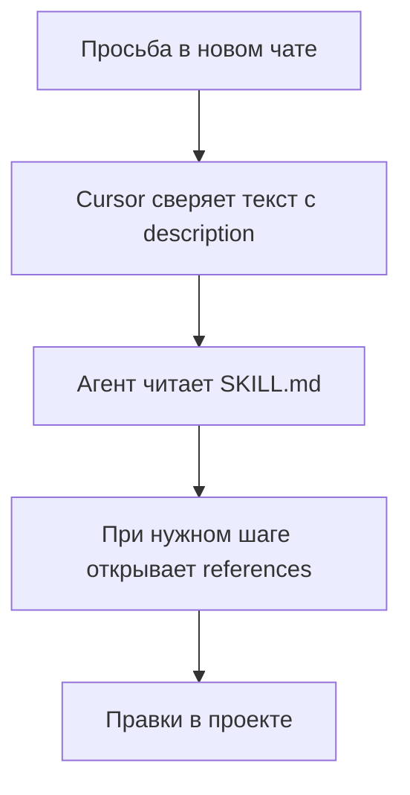

# Android skills 1.0.18 — как пользоваться в Cursor

На этом компьютере в Cursor стоит весь официальный каталог Google для агента: релиз **1.0.18**, **36 скиллов**, тот же набор, что сейчас в репозитории android/skills. Отдельно доставлять нечего. Они видны во всех проектах. Пока вы не попросите конкретную работу, приложение не меняется.

Агент читает скилл сам, когда просьба про этот API. В уже открытом чате набор мог быть зафиксирован до установки. Для проверки откройте новый чат.

## Как попросить

Напишите задачу обычным языком: что должно появиться на экране или что чинить.

Чтобы прикрепить скилл к одному сообщению, в поле ввода наберите `/` и имя, например `mlkit-agent-api`.

Чтобы держать скилл всю сессию, включите его как свой режим сочетанием Alt+Enter.

Список установленных имён: боковая панель **Customize**, раздел **Skills**.

Пустой ответ «скилл не найден» на удалённое имя `styles` — ожидаемый исход. Тема Compose по-прежнему просится словами, отдельного скилла стилей в этом релизе нет.

## Четыре новых скилла

### Диалог на устройстве — `mlkit-agent-api`

Просите, когда ассистент должен думать на телефоне через ML Kit и Gemini Nano: разговор на несколько реплик, вызов функций самого приложения, разовый вопрос без сохранения истории.

Успех: агент собирает локальный цикл и прямо пишет, что модель должна быть на устройстве. Если Nano на телефоне нет, это ограничение аппарата. Облачный Gemini в этот скилл не входит. Разовая генерация текста без инструментов — соседний скилл `ml-kit-genai-prompt-api`.

### Рисование от руки — `ink-app-builder`

Просите, когда на экране Compose нужно рисовать пальцем или стилусом: штрих в момент движения, готовые кисти (ручка, маркер, маркер-выделение), ластик, отмена и повтор, сохранение штрихов.

Успех: на экране появляется поверхность, штрих не мигает в кадр между «ещё рисую» и «уже готово». Свою форму кисти этот скилл не собирает.

### Своя кисть — `ink-custom-brush-builder`

Просите, когда нужна кисть с реакцией на нажим, наклон, скорость, шум, текстуру или несколько слоёв. Нужна библиотека Ink **1.1.0-alpha03** или новее.

Успех: в проекте появляется описание семейства кисти, которое можно поставить на уже собранную поверхность. Сам холст, ластик и сохранение штрихов — просьба к `ink-app-builder`.

### Виджет и память картинок — `glance-appwidget-updates-and-memory`

Просите, когда виджет Glance не меняется после обновления данных или когда на Android 17 приложение падает из-за тяжёлой картинки в виджете.

На Android 17 система режет память картинок в виджете. Тяжёлая картинка роняет процесс. Скилл уменьшает картинки под размер виджета и после записи состояния явно перерисовывает виджет.

Успех: виджет обновляется, картинки ужаты. Готовые макеты «как в гайде» — соседний скилл `glance-canonical-layouts`.

## Что обновилось в том же релизе

Пятнадцать скиллов заменены текстом 1.0.18. Повторять установку не нужно. Среди них: функции приложений (`appfunctions`), Navigation 3, разбор R8, производительность Compose, адаптивная вёрстка, безопасность intent и разрешений, профилировщик, виджетные макеты Glance, тесты, Wear, очки, Cast, LiteRT, Android CLI.

Имя `styles` в каталоге отсутствует: релиз его удалил. Страница обзора на developer.android.com всё ещё может упоминать «Adopt Compose Styles». В установленном наборе этого скилла нет, и ставить его заново не из чего.

## Весь набор: как просить

Имя после `/` — то, что видно в **Customize → Skills**. Фраза ниже — обычная просьба, по которой агент открывает тот же скилл сам.

### Экран

- «Сделай интерфейс адаптивным под телефон, планшет и складной» — `adaptive`.
- «Кнопки заезжают под системную панель, включи экран от края до края» — `edge-to-edge`.
- «Экран лагает, найди лишние перерисовки Compose» — `jetpack-compose-performance`.
- «Переведи этот XML-экран на Compose» — `migrate-xml-views-to-jetpack-compose`.
- «Перейди на Navigation 3: глубокие ссылки, два стека назад, диалог и список с деталями» — `navigation-3`.
- «Перехвати жест назад и покажи предсказуемую анимацию» — `navigation-event`.

### Модель на устройстве

- «Отправь одну фразу в Gemini Nano и верни структурированный ответ» — `ml-kit-genai-prompt-api`. Многоходовый агент с инструментами остаётся у `mlkit-agent-api`.
- «Открой сценарий „создать заметку“ системе, чтобы его мог вызвать агент, не открывая экран» — `appfunctions`.
- «Запусти текстовую модель `.litertlm` на процессоре или видеочипе» — `litert-lm`.
- «Подключи вывод `.tflite` через LiteRT» — `litert-runtime`.

### Виджеты, рисунок, камера, эфир

- «Собери виджет по готовому макету: список, сетка картинок или панель инструментов» — `glance-canonical-layouts`. Память картинок и принудительное обновление — `glance-appwidget-updates-and-memory`.
- Холст и готовые кисти — `ink-app-builder`. Своя кисть — `ink-custom-brush-builder`.
- «Сними видео через CameraX и повесь эффект» — `camerax`.
- «Добавь трансляцию на телевизор через Cast» — `media3-cast-integration`.

### Сборка, размер, зависания

- «Подними проект на Android Gradle Plugin 9» — `agp-9-upgrade`. Для Kotlin Multiplatform этот скилл не используется.
- «Поставь приложение на эмулятор и открой его из терминала» — `android-cli`.
- «Убери лишние правила R8, из-за которых пакет раздут» — `r8-analyzer`.
- «Разбери дамп ANR» — `anr-audit-and-fix`. Просадки кадров и трассировка системы — `android-profiler`.
- «Собери стратегию тестов: модульные, интерфейс, снимки экрана» — `testing-setup`.

### Магазин, вход, доступ

- «Проверь манифест: чужое приложение не должно перехватывать intent» — `android-intent-security`.
- «Проверь разрешения и кто может вызвать сервис» — `android-permissions-security`.
- «Сверь приложение с политиками Play» — `play-policy-insights`.
- «Обнови библиотеку покупок Play до текущей стабильной» — `play-billing-library-version-upgrade`.
- «Подключи Engage SDK и почини публикацию подборок» — `engage-sdk-integration`.
- «Включи тихий вход на новом телефоне после восстановления» — `restore-credentials`.
- «Подтверди почту без кода из письма» — `verified-email`.

### Часы, телевизор, очки, машина

- «Собери экран часов на Wear Compose Material 3» — `wear-compose-m3`.
- «Сделай виджет для Wear» — `wear-widgets`.
- «Переведи телевизор с Leanback на Compose» — `leanback-to-compose-tv-migration`.
- «Собери интерфейс очков на Glimmer» — `display-glasses-with-jetpack-compose-glimmer`.
- «Достань камеру и звук с очков» — `projected-hardware`.
- «Адаптируй видео, игру или браузер как приложение для припаркованной машины» — `android-for-cars-parked-apps`.

Успех любой такой просьбы: агент называет шаги именно этого API и трогает проект только если вы просили сделать, а не объяснить. Отказ: ответ общими словами и имя скилла через `/` не находится в **Skills**. Тогда откройте новый чат.

## Это приложение

Правила циферблата остаются. Скилл про кисть в одном из шагов упоминает другой способ внедрения зависимостей. Здесь агент оставляет тот способ, который уже принят в приложении, и не заводит лишние модули, пока вы прямо не попросите.

## Проверка

1. Откройте **Customize → Skills**. В списке есть все 36 имён из раздела «Весь набор», включая `edge-to-edge` и `mlkit-agent-api`. Имени `styles` в списке нет.
2. Откройте новый чат агента.
3. Напишите: «По скиллу mlkit-agent-api объясни, что нужно, чтобы диалог шёл на устройстве. Проект не меняй.»
4. Успех: ответ про локальную модель и цикл на телефоне, файлы приложения на месте.
5. Повторите с фразой: «По скиллу edge-to-edge объясни, что чинить, если кнопка под системной панелью. Проект не меняй.» Успех: ответ про отступы системных панелей.
6. Если ответ общий, вызовите скилл через `/` и то же имя в новом сообщении.

---

# Техническое приложение

Релиз: [v1.0.18](https://github.com/android/skills/releases/tag/v1.0.18), коммит `45fd1739a4dbca5452c3e936570797f7f6261cd7`. Ветка `main` указывает на тот же коммит. В релизе 36 скиллов. Повторная сверка: у каждого установленного каталога есть `SKILL.md`, поле `name` совпадает с именем каталога, пропусков относительно `main` нет. Каталог `jetpack-compose/theming/styles` в дереве коммита отсутствует.

## Файлы

| Путь | Зачем |
| --- | --- |
| `%USERPROFILE%\.cursor\skills\<имя>\SKILL.md` | Текст, который Cursor подмешивает агенту. 36 каталогов релиза лежат здесь, рядом с личными скиллами. |
| `%USERPROFILE%\.cursor\skills\<имя>\references\` | Подробности, агент открывает их по ссылке из `SKILL.md`. |
| `%USERPROFILE%\AppData\AndroidCLI\android.exe` | Лаунчер Android CLI. В пользовательский `Path` он уже добавлен. |
| `docs/android-agent-skills.md` | Эта инструкция. |

Личные скиллы `docs-user-then-tech`, `document-learning-commands`, `hh-otklik` не перезаписывались.

Официальная команда `android skills add` при первом запуске печатает `Downloading...` и не завершается: процесс держит соединение с Google, рабочий набор памяти не растёт. Поэтому набор снят с тега git и разложен по каталогам Cursor. Имена каталогов совпадают с полем `name` в шапке скилла.

Повторная установка поверх тех же имён затирает правки. Свой вариант переименуйте до обновления.

## Обновление

Когда `android --version` начнёт печатать версию, список агентов смотрите в `android skills add --help`. Если среди агентов есть `cursor`:

```text
android skills add --all --agent=cursor
```

Пока лаунчер не докачивает CLI, обновление то же, что и установка:

```text
git clone --depth 1 --branch v1.0.18 https://github.com/android/skills.git
```

Дальше каждый каталог, внутри которого лежит `SKILL.md`, копируется в `%USERPROFILE%\.cursor\skills\<имя каталога>`. Вложенность репозитория (`device-ai/`, `jetpack-compose/ink/`) в Cursor не переносится: Cursor берёт соседние каталоги с `SKILL.md`.

Новый чат после копирования. Текущий сеанс скиллы, появившиеся после его старта, не подхватывает.

## Скиллы релиза

| Имя | В релизе 1.0.18 | О чём просить |
| --- | --- | --- |
| `mlkit-agent-api` | новый | Диалог и инструменты на Gemini Nano |
| `ink-app-builder` | новый | Холст, готовые кисти, ластик, история штрихов |
| `ink-custom-brush-builder` | новый | Своё семейство кисти, Ink 1.1.0-alpha03+ |
| `glance-appwidget-updates-and-memory` | новый | Обновление Glance и лимит картинок на Android 17 |
| `appfunctions` | обновлён | Функции приложения для агентов |
| `litert-runtime` | обновлён | Запуск модели через LiteRT |
| `android-cli` | обновлён | Команды Android CLI |
| `adaptive` | обновлён | Адаптивная вёрстка Compose |
| `jetpack-compose-performance` | обновлён | Производительность Compose |
| `media3-cast-integration` | обновлён | Cast через Media3 |
| `navigation-3` | обновлён | Navigation 3 |
| `r8-analyzer` | обновлён | Разбор правил R8 |
| `android-profiler` | обновлён | Профилировщик |
| `android-intent-security` | обновлён | Безопасность intent |
| `android-permissions-security` | обновлён | Разрешения |
| `glance-canonical-layouts` | обновлён | Канонические макеты виджетов |
| `testing-setup` | обновлён | Каркас тестов |
| `wear-compose-m3` | обновлён | Wear Compose Material 3 |
| `display-glasses-with-jetpack-compose-glimmer` | обновлён | Очки и Compose Glimmer |
| `agp-9-upgrade` | без изменений в notes | Переход на AGP 9 |
| `android-for-cars-parked-apps` | без изменений в notes | Приложения для припаркованного авто |
| `anr-audit-and-fix` | без изменений в notes | Разбор ANR |
| `camerax` | без изменений в notes | CameraX |
| `edge-to-edge` | без изменений в notes | Экран от края до края |
| `engage-sdk-integration` | без изменений в notes | Engage SDK |
| `leanback-to-compose-tv-migration` | без изменений в notes | ТВ: Leanback → Compose |
| `litert-lm` | без изменений в notes | LiteRT LM |
| `migrate-xml-views-to-jetpack-compose` | без изменений в notes | XML → Compose |
| `ml-kit-genai-prompt-api` | без изменений в notes | Разовый Prompt API, без цикла агента |
| `navigation-event` | без изменений в notes | Navigation Event |
| `play-billing-library-version-upgrade` | без изменений в notes | Обновление Billing |
| `play-policy-insights` | без изменений в notes | Политики Play |
| `projected-hardware` | без изменений в notes | Проецируемое железо XR |
| `restore-credentials` | без изменений в notes | Восстановление учётных данных |
| `verified-email` | без изменений в notes | Подтверждённая почта |
| `wear-widgets` | без изменений в notes | Виджеты Wear |

Строка «без изменений в notes» значит: скилл есть в архиве 1.0.18, в списке обновлений этого тега его нет.

## Что агент читает первым

Шапка `mlkit-agent-api` задаёт границу: устройство, Gemini Nano, AICore. Облако и разовый Prompt API в этот текст не входят.

```yaml
name: mlkit-agent-api
description: Builds autonomous on-device agentic workflows in Android apps using the
  ML Kit GenAI Agent API powered by Gemini Nano and AICore.
```

Холст и своя кисть разведены двумя скиллами. Зависимости Ink в `ink-app-builder` держатся одной версией на все модули `androidx.ink`. Программные `BrushFamily` начинаются с `1.1.0-alpha03`.

Виджетный лимит в `glance-appwidget-updates-and-memory`: оценка потолка `6 * width * height` байт по метрикам окна, картинка заранее уменьшается под `maxWidthDp` × `maxHeightDp`. Запись состояния виджета сама по себе экран не обновляет — после неё нужен явный update.

В этом репозитории поверх скилла остаются правила из `AGENTS.md`: Koin, один модуль `:app`, без Hilt и без новых зависимостей, пока в просьбе нет отдельной фразы зачем.

## Как агент выбирает скилл



Ручной вызов `/имя` пропускает шаг сверки и прикрепляет выбранный `SKILL.md` к одному сообщению.
