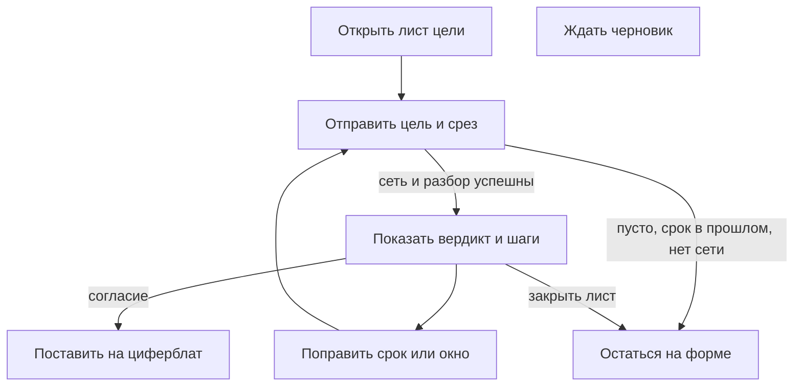
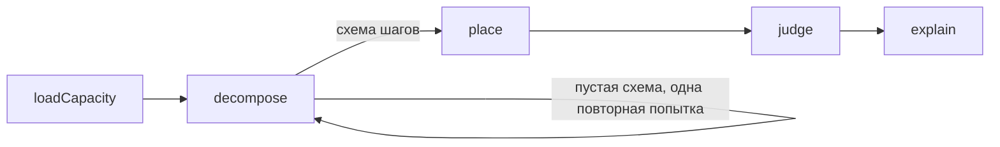

# Планировщик целей — техническое задание

Отдельная поставка поверх уже собранного циферблата. Шестинедельный канон приложения этим документом не меняется: день по-прежнему рисуется на телефоне, прошлые отрезки не переписываются, заметка отчёта остаётся текстом на устройстве.

Планировщик работает на сервере. Телефон показывает черновик и записывает задачи на циферблат только после явного согласия.

---

## Глазами пользователя

На экране задач появляется действие «Спланировать цель». Пользователь пишет, чего хочет достичь, и выбирает день, к которому это должно быть готово. Рядом видно рабочее окно: по умолчанию с 9:00 до 19:00 по местному времени. Окно можно сузить или сдвинуть в тот же день. Ночное окно через полночь в этой поставке не задаётся.

Пока запрос идёт, циферблат не меняется. Кнопка постановки на часы недоступна.

### Что приходит в ответ

Сервис возвращает три вещи: вердикт по сроку, список шагов и короткий текст, почему срок такой.

Вердикт один из трёх.

- **Помещается.** Шаги встают в свободные окна до выбранного дня, и на каждую оценку ещё остаётся запас примерно в пятую часть.
- **Впритык.** Сумма шагов умещается в свободные минуты, но запаса уже нет.
- **Не помещается.** Свободных минут не хватает, либо минуты есть, но нет цельного окна под шаг. В тексте сказано, сколько минут не хватает и что можно сделать: укоротить цель, сдвинуть день или снять с циферблата что-то необязательное.

Каждый шаг — это будущая задача: название, день, один отрезок внутри рабочего окна, важность и проект. Проект по умолчанию совпадает с названием цели, чтобы шаги собрались в уже существующую вкладку проекта. Важность влияет только на задачи без часов; шаги с дедлайном ставятся на конкретное время, а не в общий остаток половины дня.

Повторяющиеся дела занимают будущие дни так же, как если открыть этот день на циферблате. Уже стоящие встречи, закрытые отрезки и идущий таймер не сдвигаются. Прошедший отрезок сервис не предлагает править.

Черновик можно поправить до согласия: убрать шаг, перенести шаг на другой день в пределах срока, сдвинуть срок. После правки срока или окна сервис считает вердикт заново. После удаления шага пересчёт идёт на телефоне по уже полученным минутам, без нового запроса, если набор оставшихся шагов не менял оценки.

### Согласие

Кнопка «Поставить на циферблат» доступна при любом вердикте, но при «Не помещается» она ставит только те шаги, для которых нашлось цельное окно. Остальные остаются в списке как неразмещённые, на часы не попадают.

После согласия задачи видны на своих днях как обычные сектора. Цвет берётся из текущей палитры приложения. Статус новой задачи — «к выполнению». Существующие сектора на своих местах.

Пока согласия нет, уход с экрана черновика ничего не записывает. Повтор того же запроса без изменений на циферблате показывает тот же черновик.

### Отчёт

На экране «Отчёты» появляются два действия: «Собрать за сегодня» и «Собрать за неделю». Неделя — семь местных дней, включая сегодня.

Сервис смотрит закрытые отрезки и выполненные задачи за этот срок. Если по этим дням уже был принятый план, в тексте есть сравнение: что стояло в плане и что реально закрыто. Если принятого плана не было, отчёт всё равно собирается и прямо говорит, что сравнивать не с чем. Пустой день — тоже успешный отчёт: в тексте сказано, что закрытых отрезков нет.

Готовый текст появляется в том же списке заметок. Его можно поправить и удалить, как любую другую заметку. Подпись экрана, что заметки живут на устройстве, остаётся верной: на сервере не хранится дневник, сервер только составляет текст по присланному срезу.

Сбор по расписанию без кнопки задуман и в этой поставке не делается.

### Отказы

Пустая цель, день срока раньше сегодня или рабочее окно нулевой длины оставляют пользователя на форме. Циферблат не меняется. Форма объясняет, что исправить.

Нет сети, сервис недоступен или ответ не удалось разобрать — форма остаётся, показывается сообщение, уже стоящие задачи не трогаются. Повтор по кнопке безопасен.

Чужие календари, общий семейный план и вход по почте в эту поставку не входят. Телефон узнаётся по ключу, который создаётся при первом запросе и лежит на устройстве. На сервер уходит срез задач в окне от сегодня до срока: названия, отрезки, статусы, проекты и правила повтора. Описания длиннее пары строк обрезаются до короткого пояснения.

### Как проверить

1. На циферблате уже есть встреча сегодня с 10:00 до 12:00. Открыть «Спланировать цель», ввести «Подготовить отчёт», поставить срок на пятницу, оставить окно 9:00–19:00.
2. Дождаться вердикта. Встреча на циферблате на месте, новых секторов нет.
3. Нажать «Поставить на циферблат». Шаги появляются в свободных окнах, встреча не сдвинута.
4. Закрыть один шаг таймером или отрезком и отметить его выполненным.
5. На «Отчётах» нажать «Собрать за сегодня». В списке появляется заметка про этот шаг. Текст можно изменить и удалить.
6. Отключить сеть и снова нажать «Спланировать цель». Форма остаётся с сообщением, циферблат тот же.
7. Поставить срок на вчера. Форма не уходит в черновик и объясняет, что день уже прошёл.
8. Попросить объём на десятки часов к завтрашнему дню при занятом окне. Вердикт «Не помещается», без согласия новые сектора не появляются.

---

# Техническое приложение

Канон циферблата: [TZ.md](TZ.md). Это приложение его не заменяет и не снимает запрет облачных отчётов внутри шестинедельного трека. Планировщик — отдельный сервис и тонкий клиент в `:app`.

Стек сервера: Kotlin, Ktor, Koog, Postgres только для идемпотентного кэша черновика. Стек телефона не меняется: Compose, MVI, Koin, kotlinx-datetime в `kit.core`, без Hilt и без класса `Migration`. Принятый план хранится в DataStore, чтобы не поднимать версию Room.

## Файлы

| Путь | Зачем |
| --- | --- |
| `server/` | Новый модуль Ktor. В `:app` не компилируется |
| `server/src/main/kotlin/.../capacity/Capacity.kt` | Свободные окна и вердикт. Без вызова модели |
| `server/src/main/kotlin/.../agent/PlanGraph.kt` | Граф Koog: оценка шагов, затем укладка, затем текст |
| `server/src/main/kotlin/.../agent/ReportGraph.kt` | Сводка минут и текст отчёта |
| `server/src/main/kotlin/.../api/PlannerRoutes.kt` | `POST /v1/plans`, `POST /v1/reports` |
| `app/.../kit/core/Task.kt` | Контракт задачи, который клиент сериализует в срез |
| `app/.../kit/core/TimeBlock.kt` | Интервал, который укладчик имеет право предлагать |
| `app/.../kit/core/TaskReport.kt` | Куда клиент пишет текст отчёта после ответа |
| `app/.../kit/core/TaskDraftValidator.kt` | Сервер отвергает шаг с пустым названием или нулевой длиной до ответа клиенту |
| `app/.../data/PlannerPlanStore.kt` | DataStore: ключ устройства и принятые планы |
| `app/.../ui/task/PlanSheet.kt` | Лист цели, вердикт, согласие |
| `app/.../ui/stats/ReportsScreen.kt` | Кнопки сбора. Список заметок уже здесь |

Клиент шлёт шаблоны повтора и экземпляры в окне `[сегодня, срок]`. Сам горизонт на телефоне не материализуется: видимый день по-прежнему создаёт `RecurrenceMaterializer`.

## Методы и параметры

Базовый URL задаётся сборкой. Заголовок `X-Device-Key` — UUID из DataStore, создаётся при первом вызове.

`POST /v1/plans`

- Тело: `goal` (непустая строка), `deadline` (`LocalDate`, не раньше местной сегодняшней даты устройства), `zone` (IANA), `workStartMinute` и `workEndMinute` (полуинтервал внутри одних суток, `0 <= start < end <= 1440`, по умолчанию 540 и 1140), `tasks` (экземпляры и шаблоны).
- Поля задачи в срезе: `id`, `title`, `description` (не длиннее 280 символов), `blocks`, `status`, `date`, `importance`, `project`, `recurrence`, `seriesId`. Цвет клиент не шлёт: после согласия берёт `TaskPalette.defaultColor` или следующий цвет палитры.
- Ответ `200`: `draftId`, `verdict` (`FITS`, `TIGHT`, `IMPOSSIBLE`), `freeMinutes`, `usableMinutes`, `requiredMinutes`, `steps[]`, `narrative`.
- Шаг: `title`, `date`, `startMinute`, `endMinute` или `unplaced = true`, `estimateMinutes` (оценка модели), `bufferedMinutes` (`ceil(estimate * 1.2)`), `importance`, `project`.
- `409` не используется. Повтор с тем же ключом устройства и тем же хешем тела возвращает сохранённый черновик.
- `400` — пустая цель, срок в прошлом, плохое окно, блок с `end == start`. `503` — модель или разбор ответа не удались после одной повторной попытки.

Правила ёмкости, чистая функция:

- Занятость даты: закрытые блоки экземпляров этой даты плюс блоки шаблона, у которого `recurrence.occursOn(date)`, если экземпляра серии на эту дату нет.
- Открытый блок (`endMinute == null`) занимает место только на сегодняшней дате, от `startMinute` до текущей минуты. На будущих днях открытый таймер не резервирует вечер.
- Свободное окно даты = рабочий полуинтервал минус объединение занятости. Ночные блоки (`end < start`) режутся по полуночи и попадают в оба дня.
- `usableMinutes` = сумма по дням `floor(free * 4 / 5)`. `freeMinutes` — сумма без запаса.
- `requiredMinutes` — сумма `bufferedMinutes` шагов.
- `FITS`, если каждый шаг лёг цельным куском и `requiredMinutes <= usableMinutes`.
- `TIGHT`, если все шаги легли и `usableMinutes < requiredMinutes <= freeMinutes`. Для укладки «впритык» длина куска равна `estimateMinutes`, запас в вердикте уже не требуется.
- `IMPOSSIBLE`, если суммы не хватает или хотя бы один шаг не лёг в один непрерывный свободный кусок. Шаг не дробится на несколько блоков.
- Укладка жадная: самый длинный шаг в самое раннее подходящее окно. Существующие блоки не двигаются.

`POST /v1/reports`

- Тело: `from`, `to`, `zone`, `tasks` за эти даты, `acceptedPlans` (то, что телефон прочитал из DataStore; может быть пустым).
- Ответ: `text` (готовый абзац), `doneMinutes`, `plannedMinutes`.
- `doneMinutes` — сумма длительностей закрытых блоков за период. Выполненная задача без блоков даёт 0 минут и попадает в текст только названием.
- Пустой период — `200` и честный текст, не ошибка.

Клиент после согласия пишет обычные `Task` через `TaskRepository.upsert` и кладёт план в DataStore. Комната задач не меняет схему. Текст отчёта: если у принятого плана есть безвременная якорная задача с названием цели, заметка вешается на неё; иначе клиент создаёт одну безвременную задачу «Отчёт yyyy-mm-dd» и делает `ReportRepository.upsert`. Экран отчётов по-прежнему не создаёт заметку без `taskId`.

Граф плана в Koog, по порядку: `loadCapacity` (код) → `decompose` (модель, схема шагов) → `place` (код) → `judge` (код) → `explain` (модель, только `narrative`, числа из `judge` передаются как неизменяемый вход). Вердикт из текста модели не читается.

Модель один раз заменяется повторным вызовом, если схема пустая или минуты шага меньше 1. Вторая неудача — `503`.

## Примеры кода

Задача, которую срез повторяет. Пустой `blocks` — без часов; несколько блоков — несколько секторов. Фрагмент `Task.kt`.

```kotlin
data class Task(
    val id: TaskId,
    val title: String,
    val description: String = "",
    val colorArgb: Long,
    val blocks: List<TimeBlock> = emptyList(),
    val status: TaskStatus = TaskStatus.TODO,
    val date: LocalDate?,
    val importance: Importance = Importance.MEDIUM,
    val project: String? = null,
    val recurrence: RecurrenceRule = RecurrenceRule.None,
    val seriesId: String? = null,
)
```

Отрезок, который укладчик имеет право выдать. `null` у конца — только живой таймер на телефоне; черновик планировщика всегда закрыт. Фрагмент `TimeBlock.kt`.

```kotlin
data class TimeBlock(
    val startMinute: Int,
    val endMinute: Int? = null,
) {
    val isOpen: Boolean get() = endMinute == null
}
```

Сутки, с которыми совпадают минуты рабочего окна. Фрагмент `TimeMath.kt`.

```kotlin
object TimeMath {
    const val MINUTES_PER_DAY: Int = 1440
    const val MINUTES_PER_HALF: Int = 720
    const val DEGREES_CIRCLE: Float = 360f
}
```

Будущая занятость считается этим правилом на сервере. Телефон заранее экземпляры не создаёт. Фрагмент `RecurrenceRule.kt`.

```kotlin
fun occursOn(date: LocalDate): Boolean = when (this) {
    None -> false
    Daily -> true
    is Weekdays -> date.dayOfWeek in days
}
```

Веса важности не используются для шага, у которого уже есть часы. Фрагмент `Importance.kt`.

```kotlin
enum class Importance(val leftoverWeight: Int) {
    HIGH(5),
    MEDIUM(3),
    LOW(2),
}
```

Заметка отчёта. Облачного хранилища у неё нет: сервер возвращает строку, клиент вызывает `upsert`. Фрагмент `TaskReport.kt`.

```kotlin
data class TaskReport(
    val id: ReportId,
    val taskId: TaskId,
    val createdAtEpochMillis: Long,
    val text: String,
)
```

## Блок-схемы




